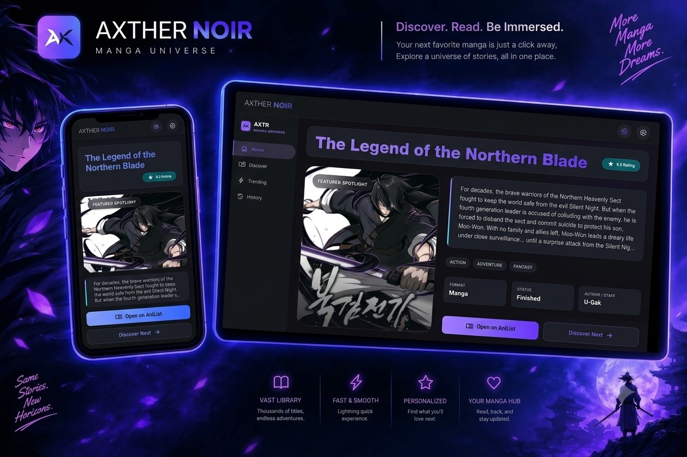

# [Axther - Manga Universe](http://axhter.netlify.app/)

> **Discover. Read. Be Immersed.** Your next favorite manga is just a click away. Explore a universe of stories, all in one place.

## 🌌 About The Project

**Axther** is a modern, high-performance web application designed for manga and light novel enthusiasts. Built with a sleek dark-themed aesthetic and ambient lighting effects, it serves as an immersive discovery hub where users can instantly find, filter, and explore titles powered by live AniList databases.

Whether you are browsing on a desktop or navigating via mobile with a quick thumb-friendly layout, Axther Noir delivers a seamless experience with zero friction.

---

## ✨ Key Features

- **🎲 Instant Random Discovery:** Jump straight into top-tier titles, complete with synopses, ratings, formats, and staff/author info.
- **📱 Fully Responsive Design:** Features a fluid layout that transforms gracefully—including a mobile-optimized bottom navigation bar with intelligent scroll behavior.
- **⚡ Lightning Fast & Smooth:** Built using modern frontend tooling for optimized rendering and instant data fetching.
- **🎯 Tailored Filters:** Customize your discovery parameters based on formats, ratings, and content preferences.
- **🕒 Live Session History:** Keep track of everything you've discovered during your session with local state synchronization.

---

## 🛠️ Technology Stack

- **Core Framework:** React / Single-Page Application (SPA) Routing via Wouter
- **State Management:** Jotai (for atomic, lightning-fast cross-component synchronization)
- **Styling:** Tailwind CSS (featuring custom design tokens, bento-style card grids, and glassmorphism)
- **Data Source:** AniList GraphQL API
- **Deployment & Hosting:** Netlify
